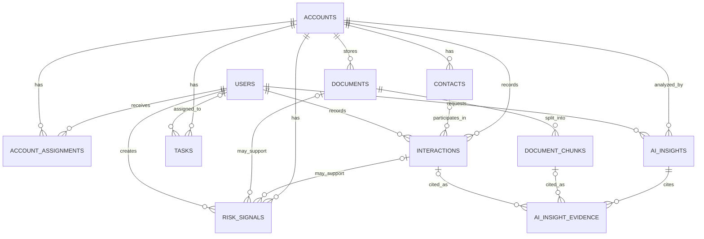

# Customer Success Risk Intelligence Platform — Data Model

**Document:** `DATA_MODEL.md`
**Version:** 0.2 — updated to owner decisions
**Status:** Working v1 baseline
**Related document:** `docs/REQUIREMENTS.md`

## 1. Purpose

This document proposes how the platform's information will be represented in PostgreSQL and how records relate to one another. It is a design proposal, not a claim that every field or relationship is already approved.

The assignment names seven core business entities: Accounts, Contacts, Interactions, Tasks, Risk Signals, Documents, and AI Insights. The implementation also needs supporting records for users and authorization, and for document chunks and AI citations.

## 2. Main design principles

1. **One source of truth:** Store each fact in the table that represents it. Do not place every contact, interaction, and task into one large account record.
2. **Explicit relationships:** Use foreign keys so the database can identify which account a contact, task, interaction, document, or insight belongs to.
3. **Authorization scope:** V1 has the `csm` role only. A user can access an account only through `account_assignments`. Authorization must be enforced by the backend, not only by the frontend.
4. **Keep facts separate from AI analysis:** The account's stored risk level is not the same field as an AI insight's suggested risk level.
5. **Preserve useful history:** Archive or resolve records when history matters instead of casually hard-deleting source records.
6. **Evidence traceability:** An AI insight's citations must point to source records/chunks that were actually retrieved and authorized.
7. **Avoid premature complexity:** Fields marked provisional or optional need validation against the approved requirements and team-lead feedback.

## 3. Proposed entity relationship diagram

**How to read it:** `ACCOUNTS ||--o{ CONTACTS` means one account can have zero or many contacts, while every contact belongs to one account. The same account-centred pattern applies to most of the other core records.

The diagram is conceptual. Optional references, check constraints, role/team scope, and deletion behavior must still be implemented and tested explicitly.

## 4. Core business entities

### 4.1 `accounts`

Represents a customer organization, **not** a bank or financial account.

| Field | Proposed type | Purpose / rule |
|---|---|---|
| `id` | UUID, primary key | Stable account identifier |
| `name` | VARCHAR, required | Customer organization name |
| `industry` | VARCHAR, optional | Industry, if useful for search/display |
| `domain` | VARCHAR, optional | Customer domain, if available |
| `status` | ENUM, required | V1 values: `active`, `renewal_pending`, `churned` |
| `risk_level` | ENUM, nullable | `low`, `medium`, `high`, `critical`; null means not assessed yet, not low risk |
| `renewal_date` | DATE, optional | Used for renewal-window filtering |
| `created_at` | TIMESTAMPTZ | Record creation time |
| `updated_at` | TIMESTAMPTZ | Last update time |
| `archived_at` | TIMESTAMPTZ, nullable | Null means not archived |

**Important decision:** `risk_level` represents the currently stored, rule-based or CSM-set risk value. An AI-generated suggested risk level is stored on an `ai_insights` record, not written over `accounts.risk_level` automatically.

**Decision:** `at_risk` is not an account status in v1. Status (`active`, `renewal_pending`, `churned`) and risk level (`low`, `medium`, `high`, `critical`) are separate fields.

### 4.2 `contacts`

Represents a person associated with a customer account.

| Field | Proposed type | Purpose / rule |
|---|---|---|
| `id` | UUID, primary key | Contact identifier |
| `account_id` | UUID, FK to `accounts.id`, required | The account this person belongs to |
| `full_name` | VARCHAR, required | Contact name |
| `email` | VARCHAR, optional | Contact email; do not assume globally unique without a business rule |
| `phone` | VARCHAR, optional | Contact phone |
| `title` | VARCHAR, optional | Job title/role at the customer |
| `created_at`, `updated_at` | TIMESTAMPTZ | Audit timestamps |
| `archived_at` | TIMESTAMPTZ, nullable | Supports archive rather than accidental hard deletion |

Relationship: one account can have many contacts; a contact belongs to one account in this v1 model.

### 4.3 `interactions`

Represents an event or source record such as a support conversation, call, meeting summary, product feedback item, or account note. A separate `notes` table is not proposed for v1; notes can be an interaction type unless a more specific requirement emerges.

| Field | Proposed type | Purpose / rule |
|---|---|---|
| `id` | UUID, primary key | Interaction identifier |
| `account_id` | UUID, FK to `accounts.id`, required | Account related to the interaction |
| `contact_id` | UUID, FK to `contacts.id`, nullable | Contact involved, if known |
| `created_by_user_id` | UUID, FK to `users.id`, nullable for imported/seed records | User who entered the record |
| `type` | ENUM, required | Provisional values: `note`, `support`, `meeting`, `call`, `product_feedback`, `other` |
| `title` | VARCHAR, required | Short label |
| `content` | TEXT, required | Notes, summary, or details |
| `occurred_at` | TIMESTAMPTZ, required | When the real interaction occurred |
| `created_at`, `updated_at` | TIMESTAMPTZ | System audit timestamps |
| `archived_at` | TIMESTAMPTZ, nullable | Archive/correction lifecycle; preserve source history |

Relationship: an account has many interactions. A contact may be associated with many interactions, but some interactions may not identify a particular contact.

Validation: if `contact_id` is present, verify that the contact belongs to the same `account_id`; a contact ID must not be used to attach an interaction to a different account.

### 4.4 `tasks`

Represents follow-up work associated with a customer account.

| Field | Proposed type | Purpose / rule |
|---|---|---|
| `id` | UUID, primary key | Task identifier |
| `account_id` | UUID, FK to `accounts.id`, required | Account the task concerns |
| `assignee_user_id` | UUID, FK to `users.id`, required | User responsible for the task |
| `created_by_user_id` | UUID, FK to `users.id`, required | User who created it |
| `title` | VARCHAR, required | Short task description |
| `description` | TEXT, optional | Additional detail |
| `priority` | ENUM, required | V1 values: `low`, `medium`, `high`, `urgent` |
| `due_date` | DATE, optional until the team decides whether every task needs one | Follow-up due date |
| `status` | ENUM, required | `open`, `in_progress`, `done` |
| `completed_at` | TIMESTAMPTZ, nullable | When marked done |
| `created_at`, `updated_at` | TIMESTAMPTZ | Audit timestamps |
| `archived_at` | TIMESTAMPTZ, nullable | Optional archive/cancel handling |

The `overdue` indicator should normally be computed, not stored as a manually updated status: a task is overdue when it has a due date in the past and its status is not `done` (subject to agreed timezone/date rules).

### 4.5 `risk_signals`

Represents a structured flag about a possible problem with an account. It is not the original interaction and is not the same as a generated AI insight.

| Field | Proposed type | Purpose / rule |
|---|---|---|
| `id` | UUID, primary key | Signal identifier |
| `account_id` | UUID, FK to `accounts.id`, required | Account that may be at risk |
| `source_interaction_id` | UUID, FK to `interactions.id`, nullable | Source interaction if applicable |
| `source_document_id` | UUID, FK to `documents.id`, nullable | Source document if applicable |
| `source_description` | TEXT, optional | Explanation for a manually entered/rule-based source if no source record is linked |
| `origin` | ENUM, required | `manual` or `rule` |
| `rule_code` | VARCHAR, nullable | Identifies the rule when created by a rule |
| `signal_type` | VARCHAR/ENUM, required | E.g. repeated_support_issue; initial catalogue remains to be defined |
| `description` | TEXT, required | Why this signal exists |
| `severity` | ENUM, optional | `low`, `medium`, `high`, `critical`, if severity is needed separately from account risk |
| `status` | ENUM, required | `active`, `acknowledged`, `resolved`, `dismissed` |
| `created_by_user_id` | UUID, FK to `users.id`, nullable | Null for automated rule creation if no acting user is appropriate |
| `resolution_reason` | TEXT, nullable | Required when dismissed/resolved if the policy demands a reason |
| `resolved_at` | TIMESTAMPTZ, nullable | Resolution/dismissal timestamp |
| `created_at`, `updated_at` | TIMESTAMPTZ | Audit timestamps |

Integrity rules to implement: a signal must belong to the same account as its source interaction/document; dismissed signals must retain their reason; resolved/dismissed signals remain available for audit. Define the exact source requirement before adding a database `CHECK` constraint.

### 4.6 `documents`

Represents an uploaded customer document. The file itself should normally be stored in private file/object storage; PostgreSQL stores its metadata and a storage reference.

| Field | Proposed type | Purpose / rule |
|---|---|---|
| `id` | UUID, primary key | Document identifier |
| `account_id` | UUID, FK to `accounts.id`, required | Owning account; used in access isolation |
| `uploaded_by_user_id` | UUID, FK to `users.id`, required | User who uploaded the file |
| `title` | VARCHAR, required | Human-readable document title |
| `original_filename` | VARCHAR, required | Original file name |
| `mime_type` | VARCHAR, required | Validated content type; never trust extension alone |
| `size_bytes` | BIGINT, required | Must be no larger than 10 MB in v1 |
| `content_sha256` | CHAR(64), required | Content hash for duplicate detection |
| `storage_key` | VARCHAR, required | Private-storage reference, not a public URL |
| `ingestion_status` | ENUM, required | `uploaded`, `processing`, `ready`, `failed` |
| `ingestion_error_code` | VARCHAR, nullable | Safe error category; avoid storing secrets in errors |
| `created_at`, `updated_at` | TIMESTAMPTZ | Audit timestamps |
| `archived_at` | TIMESTAMPTZ, nullable | Archived documents must be excluded from normal retrieval |

Recommended unique constraint: `(account_id, content_sha256)`. This allows the same bytes to exist for different accounts if business policy permits it, but prevents repeat uploads of the same content into one account. V1 rule: archived documents remain deduplicated by `(account_id, content_sha256)` unless a deliberate restore workflow is used.

Supported v1 formats proposed in requirements: PDF, TXT, Markdown. DOCX is optional and should not block the core path.

### 4.7 `ai_insights`

Represents a generated, advisory analysis of one account. Treat each generation as a distinct result so users can understand when it was generated and what evidence it used.

| Field | Proposed type | Purpose / rule |
|---|---|---|
| `id` | UUID, primary key | Insight identifier |
| `account_id` | UUID, FK to `accounts.id`, required | Account being analyzed |
| `requested_by_user_id` | UUID, FK to `users.id`, required | User who requested the analysis |
| `status` | ENUM, required | `pending`, `completed`, `failed` |
| `suggested_risk_level` | ENUM, nullable | `low`, `medium`, `high`, `critical`; AI recommendation only |
| `summary` | TEXT, nullable until completed | Short synthesis of the evidence |
| `risk_factors` | JSONB, nullable until completed | Structured list of risk factors |
| `recommended_actions` | JSONB, nullable until completed | Structured list of possible actions |
| `confidence` | ENUM, nullable | V1 values: `low`, `medium`, `high` |
| `model_name` | VARCHAR, nullable | Model used, where safe/useful to record |
| `prompt_version` | VARCHAR, nullable | Helps track changes to analysis instructions/schema |
| `created_at` | TIMESTAMPTZ | Request/creation time |
| `completed_at` | TIMESTAMPTZ, nullable | Completion time |
| `error_code` | VARCHAR, nullable | Safe failure category when generation fails |

AI insights are generated and viewed, not edited as if they were source facts. If the model returns invalid output or citations, do not mark it as a trusted `completed` insight; fail safely and record an appropriate error state.

## 5. Supporting tables required by the design

These support authorization and RAG. They do not replace the seven core business entities named in the challenge.

### 5.1 `users`

| Field | Proposed type | Purpose / rule |
|---|---|---|
| `id` | UUID, primary key | User identifier |
| `full_name` | VARCHAR, required | Display name |
| `email` | VARCHAR, required, unique | Login/identity field in a local-auth design |
| `password_hash` | VARCHAR, conditional | Store only a secure password hash if local password authentication is selected; never store plaintext passwords |
| `role` | ENUM, required | V1 role: `csm` only; Manager/Admin roles are out of scope |
| `is_active` | BOOLEAN | Disable access without deleting user history |
| `created_at`, `updated_at` | TIMESTAMPTZ | Audit timestamps |

V1 uses email/password login with JWT bearer tokens. Store only a secure password hash, never plaintext passwords, and never return the hash in API responses.

### 5.2 `account_assignments`

Represents which users may access which accounts. This is a many-to-many relationship: a CSM may be assigned multiple accounts, and an account may have multiple assigned users.

| Field | Proposed type | Purpose / rule |
|---|---|---|
| `account_id` | UUID, FK to `accounts.id` | Assigned account |
| `user_id` | UUID, FK to `users.id` | User receiving access |
| `assigned_by_user_id` | UUID, FK to `users.id`, nullable | Who created the assignment |
| `assigned_at` | TIMESTAMPTZ | When assignment started |

Use composite primary key or unique constraint on `(account_id, user_id)` to prevent duplicate assignments. Backend account queries must establish the user's allowed account IDs first, then apply search filters. A client-supplied account ID is not authorization.

**V1 role decision:** Only CSM users are needed. At least two CSM test users will have different account assignments to test cross-account authorization. No manager/team tables are needed for v1.

### 5.3 `document_chunks`

RAG splits extracted document text into smaller chunks for retrieval. Store chunks separately rather than repeating the whole document text on every query.

| Field | Proposed type | Purpose / rule |
|---|---|---|
| `id` | UUID, primary key | Chunk identifier; can be used for citations |
| `document_id` | UUID, FK to `documents.id`, required | Parent document |
| `account_id` | UUID, FK to `accounts.id`, required | Explicit scope filter for retrieval; must match the document's account |
| `chunk_index` | INTEGER, required | Chunk order within the document |
| `chunk_text` | TEXT, required | Extracted passage used as evidence |
| `embedding` | pgvector vector(1024) | Vector for Jina `jina-embeddings-v3`; configured dimension is 1024 |
| `metadata` | JSONB, optional | Page number, heading, or extraction metadata where available |
| `created_at` | TIMESTAMPTZ | Chunk creation time |

Recommended unique constraint: `(document_id, chunk_index)`. Jina `jina-embeddings-v3` is configured for 1024 dimensions; verify the returned dimension before storing each vector. During retrieval, filter by authorized account scope before passing chunks to the LLM.

### 5.4 `ai_insight_evidence`

Stores the evidence references attached to an AI insight. A dedicated table makes citations traceable and avoids treating model-generated source names as trustworthy.

| Field | Proposed type | Purpose / rule |
|---|---|---|
| `id` | UUID, primary key | Citation/evidence row identifier |
| `ai_insight_id` | UUID, FK to `ai_insights.id`, required | Insight using the evidence |
| `document_chunk_id` | UUID, FK to `document_chunks.id`, nullable | Cited document passage, if applicable |
| `interaction_id` | UUID, FK to `interactions.id`, nullable | Cited interaction, if applicable |
| `excerpt` | TEXT, required | Exact excerpt shown to the user, taken from the retrieved source |
| `claim_supported` | TEXT, optional | Finding/risk factor this evidence supports |
| `citation_order` | INTEGER, required | Stable display order |
| `created_at` | TIMESTAMPTZ | Evidence-row creation time |

Exactly one of `document_chunk_id` or `interaction_id` should be populated for a row. Enforce this with a database check constraint. The backend must also validate that the cited source and insight belong to the same authorized account and that the excerpt matches retrieved source content.

## 6. Relationship summary

| Relationship | Cardinality | Why it exists |
|---|---|---|
| Account → Contacts | One-to-many | One customer organization can have many people |
| Account → Interactions | One-to-many | A customer can have many calls, notes, meetings, and support events |
| Contact → Interactions | One-to-many, optional on interaction | An interaction may involve a known contact or only the account |
| Account → Tasks | One-to-many | One account can have many follow-up tasks |
| User → Assigned Tasks | One-to-many | A user can be responsible for multiple tasks |
| User ↔ Account | Many-to-many through `account_assignments` | Users can own/access many accounts; an account can be shared with multiple authorized users |
| Account → Risk Signals | One-to-many | An account can have multiple current or historical risk signals |
| Account → Documents | One-to-many | Each document belongs to one customer account |
| Document → Document Chunks | One-to-many | One document is split into passages for retrieval |
| Account → AI Insights | One-to-many | An account can have multiple analyses over time |
| AI Insight → Evidence | One-to-many | One analysis may cite multiple source passages/records |

## 7. Proposed constraints and data integrity rules

- All core records have primary keys, and all account-owned records carry a valid `account_id` foreign key.
- Do not allow a contact, interaction, risk signal, task, document, or AI insight to be attached to an account outside the user's permitted scope.
- When a record references both `account_id` and a child/source record ID, ensure both point to the same account. Do not rely on the frontend for this check.
- A risk signal's source interaction or document, when present, must belong to the same account as the signal.
- A document chunk must belong to the same account as its parent document.
- An AI insight's evidence source must belong to the same account as the insight; validate before returning results.
- Use a unique `(account_id, content_sha256)` rule for duplicate document detection, with a defined behavior for already archived files.
- Use timestamps in a consistent timezone (prefer UTC in storage). Define how user-local due dates are interpreted.
- Archived accounts/documents must not appear in normal lists or RAG retrieval unless an authorized workflow explicitly includes them.
- Restrict or avoid hard deletes when child records, citations, or audit history depend on the source. Define deliberate foreign-key deletion behavior; do not rely on database cascade deletion by default.
- Pagination and appropriate indexes are needed for account lists and filters. Query/index design should be validated with the required performance test rather than assumed optimal.

## 8. Indexes to consider

Create indexes only where supported by the query patterns, then verify performance. Initial candidates:

- `account_assignments(user_id, account_id)` and `account_assignments(account_id, user_id)`.
- `contacts(account_id)`; optionally `contacts(email)` if email lookup is required.
- `interactions(account_id, occurred_at DESC)` and `interactions(contact_id)`.
- `tasks(account_id, status, due_date)` and `tasks(assignee_user_id, status, due_date)`.
- `risk_signals(account_id, status)`.
- `documents(account_id, ingestion_status)` plus unique `(account_id, content_sha256)`.
- `document_chunks(account_id)` and the vector index selected for the chosen embedding model/database setup.
- `ai_insights(account_id, created_at DESC)` and `ai_insight_evidence(ai_insight_id)`.

Do not add every index blindly; indexes cost storage and can slow writes. Measure representative queries and adjust.

## 9. Decisions captured for v1

1. **Roles:** Only the `csm` role is implemented in v1. Seed two CSM users with different `account_assignments` for authorization tests.
2. **Status/risk:** Status is `active`, `renewal_pending`, or `churned`; risk is `low`, `medium`, `high`, or `critical`. `at_risk` is not a status value.
3. **Tasks:** Include an assignee, priority, due date, status, and computed overdue state. The implementation should make the due-date nullability explicit in the schema.
4. **Contacts:** Fields are name, email, phone, and title. Do not make email globally unique because different accounts may share a contact address unless a real requirement justifies it.
5. **Risk sources:** A risk signal may have a primary interaction or document as its source in v1. If multiple-source provenance becomes necessary, add a `risk_signal_sources` junction table.
6. **Deletion:** Accounts, interactions, and documents use archive/soft-delete; contacts and tasks support delete. AI insights are generate/view only; risk signals are resolved/dismissed and retained.
7. **Authentication/providers:** Use JWT bearer authentication, Groq via its OpenAI-compatible API, and Jina `jina-embeddings-v3` with 1024 dimensions. Actual keys belong only in local `.env`, never in docs/source control.
8. **Limits/targets:** 10 MB per document, ~500 seeded accounts, page size default 20/max 100, non-AI API p95 target 500 ms, and AI timeout 30 seconds are test targets, not performance claims.
9. **Retention:** Retention duration is undefined; do not implement automatic purge in v1.

## 10. How this data model supports the product flow

1. The CSM signs in and the backend identifies the user.
2. The backend obtains the accounts that user is authorized to access through `account_assignments`.
3. The dashboard queries only those accounts and their related status, risk, interactions, and tasks.
4. When the CSM requests analysis, the backend verifies access to the selected account.
5. Retrieval searches only document chunks and interaction evidence belonging to that authorized account scope.
6. The AI returns structured analysis; the backend validates the schema, evidence references, and citations.
7. A valid insight is stored separately from the account's stored risk level and displayed with source evidence.

This is the working v1 data-model baseline. Keep it consistent with `REQUIREMENTS.md`; document and test any later change that alters these decisions.
